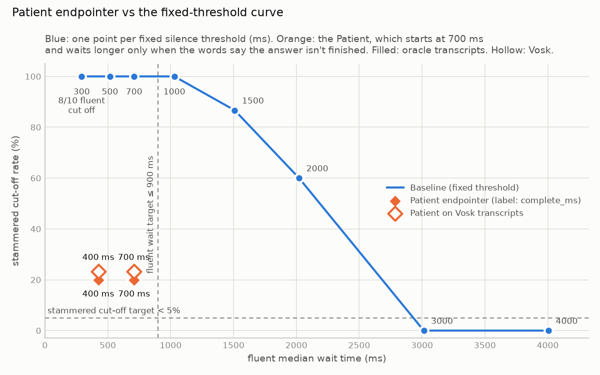
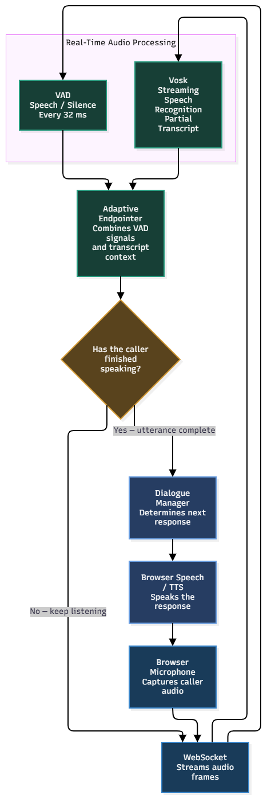

# Unhurried

Unhurried is a program that doesn't cut off people who stammer.

In a study of people who stutter [Lea et al., Apple, 2023](https://arxiv.org/pdf/2302.09044):
- The most common complaint (61%) was that voice assistants cut them off before they had finished.
- When asked why, 77% said a pause in their speech made the system think they had stopped talking.
- A 2025 [STAMMA](https://stamma.org/sites/default/files/2025-10/2025%20Report%20on%20phone%20accessibility_2.pdf) survey found 65% of phone calls made by people who stammer were mishandled. E.g. callers were talked over, interrupted, trapped in voice recognition loops, and hung up on.

Unhurried minimises those problems, while keeping a good balance of waiting time for fluent and stammered people.

## Results

On my test set with my own voice, (with stammers inserted at known points) and using real offline speech recognition (Vosk):

| Line | Stammered callers cut off | Fluent median wait | Fluent p95 wait | Thinking pauses cut off |
| --- | --- | --- | --- | --- |
| Baseline, 0.7 s timeout | 100% (30/30) | 710 ms | 722 ms | 100% (4/4) |
| Baseline, 3 s timeout | 0% (0/30) | 3014 ms | 3026 ms | 0% (0/4) |
| **Unhurried** | **23% (7/30)** | **707 ms** | **722 ms** | **0% (0/4)** |

A fixed timeout can only stop cutting people off by making **everyone** wait longer (3s here). Unhurried waits longer only when the words show the answer isn't finished. For example, when someone says "my account number is...", or the user only says 4 out of 8 digits. This makes fluent callers wait no longer than with the 0.7s baseline.



- Full tables: [eval/results/results.md](eval/results/results.md)
- My interpretation: [eval/results/discussion.md](eval/results/discussion.md)

## How it works

This is a data diagram I made in draw.io, which shows how the system works overall:



- **Endpointer:** starts at the baseline's 0.7 s, but if the answer is provably unfinished, silence alone never ends the turn. After 6s it says "Take your time" and keeps listening. It never hangs up.
- **Completeness rules:** read the words against the question asked (8 digits for an account number, day + month + year for a date, yes/no for a confirmation). I decided not to use an LLM as rules take microseconds instead of hundreds of milliseconds, which would add a lot of latency.
- **Read back:** the bot repeats what it heard so the caller can correct speech recognition mistakes.
- **Keypad:** always available instead of speaking


## Run the demo

- Requirements: Python 3.12 with [uv](https://docs.astral.sh/uv/), Node 20+ and Chrome.
- Install dependencies and Vosk model:
```shell
uv sync
uv run python -m eval.download_model                  # once: the offline Vosk model
```

- Then, in two terminals:

```shell
uv run uvicorn unhurried.server:app --port 8000       # terminal 1: backend
cd frontend && npm install && npm run dev             # terminal 2: frontend
```

- Open http://localhost:5173. The Vite dev server proxies `/ws` to the backend on port 8000
- Click "Call Northwind Energy", choose Sample caller
- Try Baseline (previous model, which cuts off people who stammer)
- Try Unhurried, which understands behaviour and gives people who stammer time

## Tests
```shell
uv run pytest
```

## How to use it
- **Line**: Baseline is a fixed 0.7 seconds silence timeout like many simple voice systems have or Unhurried, which waits longer only when the words show the answer isn’t finished.
- **Play sample caller** streams recorded answers from `eval/data/demo/` through the same WebSocket as a microphone, so the demo works without anyone speaking. The script is: account number with a stammer, "No, it's 4 5 2 1 8 8 3 1" (correcting the read-back), yes, date of birth, yes, reason for calling.
  - It behaves like a caller who gets cut off. If the bot replies before the caller has finished speaking (the clip's `true_end_ms` in `eval/data/demo/manifest.csv`), the clip stops and the same answer is given again at the next question. A reply after that point is normal, and the next answer follows.
  - Between answers it waits for the bot to finish speaking, then sends silence until the bot replies (at most 7 s). It stops when the call ends or the script runs out.
  - The same caller runs from the command line: `uv run python scripts/stream_call.py --caller --endpointer baseline eval/data/demo/{A1_stammered,C2,C1,D1,C1,R2}.wav`
- **My microphone** captures 16 kHz mono PCM16 in the browser (an AudioWorklet resamples it) and mutes outgoing audio while the bot speaks. Use headphones so Vosk understands better.
- **Keypad** is always available as an alternative to speaking, which solves the looping issue people who stammer were facing.


## AI Use
See [ai.md](ai.md)