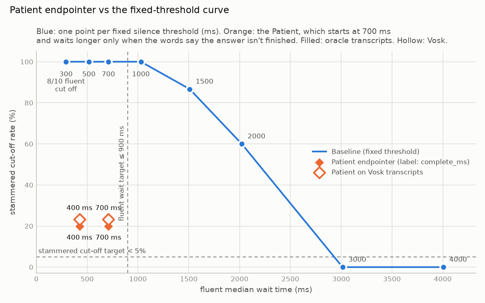

# Results: Patient endpointer vs the Baseline

Generated by `uv run python -m eval.sweep --stt vosk`; do not edit by hand. Interpretation: [discussion.md](discussion.md).

44 clips from the manifest, same VAD, frames and scoring as [the Baseline sweep](sweep.md).
`complete_ms` is the silence that ends a COMPLETE answer; base patience is 700 ms.
The Patient runs twice on the same audio: once on oracle transcripts, once on Vosk's.

## Summary

| endpointer | stammered cut-off (target < 5%) | fluent median wait (ms, target ≤ 900) | fluent p95 wait (ms) | fluent no END | fluent cut-off | pauses cut-off | both targets met |
| --- | ---: | ---: | ---: | ---: | ---: | ---: | :---: |
| Baseline 700 ms | 100% (30/30) | 710 | 722 | 0/10 | 0% (0/10) | 100% (4/4) | ❌ |
| Baseline 3000 ms (first to meet the stammered target) | 0% (0/30) | 3014 | 3026 | 0/10 | 0% (0/10) | 0% (0/4) | ❌ |
| **Patient (oracle transcripts), complete 700 ms** | 20% (6/30) | 710 | 722 | 0/10 | 0% (0/10) | 100% (4/4) | ❌ |
| **Patient (oracle transcripts), complete 400 ms** | 20% (6/30) | 424 | 707 | 0/10 | 0% (0/10) | 100% (4/4) | ❌ |
| **Patient (Vosk transcripts), complete 700 ms** | 23% (7/30) | 707 | 722 | 1/10 | 0% (0/10) | 0% (0/4) | ❌ |
| **Patient (Vosk transcripts), complete 400 ms** | 23% (7/30) | 425 | 708 | 1/10 | 0% (0/10) | 0% (0/4) | ❌ |

## Per group

### Patient (oracle transcripts), complete 700 ms

| group | clips | cut-off rate | no END | prompted | wait median (ms) | wait p95 (ms) |
| --- | ---: | ---: | ---: | ---: | ---: | ---: |
| fluent | 10 | 0% (0/10) | 0/10 | 0/10 | 710 | 722 |
| stammered | 30 | 20% (6/30) | 0/30 | 0/30 | 714 | 724 |
| pauses | 4 | 100% (4/4) | 0/4 | 0/4 | - | - |

### Patient (oracle transcripts), complete 400 ms

| group | clips | cut-off rate | no END | prompted | wait median (ms) | wait p95 (ms) |
| --- | ---: | ---: | ---: | ---: | ---: | ---: |
| fluent | 10 | 0% (0/10) | 0/10 | 0/10 | 424 | 707 |
| stammered | 30 | 20% (6/30) | 0/30 | 0/30 | 426 | 706 |
| pauses | 4 | 100% (4/4) | 0/4 | 0/4 | - | - |

### Patient (Vosk transcripts), complete 700 ms

| group | clips | cut-off rate | no END | prompted | wait median (ms) | wait p95 (ms) |
| --- | ---: | ---: | ---: | ---: | ---: | ---: |
| fluent | 10 | 0% (0/10) | 1/10 | 1/10 | 707 | 722 |
| stammered | 30 | 23% (7/30) | 5/30 | 5/30 | 714 | 1733 |
| pauses | 4 | 0% (0/4) | 0/4 | 0/4 | 717 | 1083 |

### Patient (Vosk transcripts), complete 400 ms

| group | clips | cut-off rate | no END | prompted | wait median (ms) | wait p95 (ms) |
| --- | ---: | ---: | ---: | ---: | ---: | ---: |
| fluent | 10 | 0% (0/10) | 1/10 | 1/10 | 425 | 708 |
| stammered | 30 | 23% (7/30) | 5/30 | 5/30 | 426 | 1733 |
| pauses | 4 | 0% (0/4) | 0/4 | 0/4 | 568 | 1079 |

## Every Patient miss

| clip | transcripts | outcome | at complete_ms | reason at the END |
| --- | --- | --- | --- | --- |
| clips/stammered/R2_v1.wav | oracle | cut_off | 700, 400 | silence 704ms >= patience 700ms: unsure: free text |
| clips/stammered/R2_v2.wav | oracle | cut_off | 700, 400 | silence 704ms >= patience 700ms: unsure: free text |
| clips/stammered/R2_v3.wav | oracle | cut_off | 700, 400 | silence 704ms >= patience 700ms: unsure: free text |
| clips/stammered/C1_v1.wav | oracle | cut_off | 700, 400 | silence 704ms >= patience 700ms: unsure: nothing heard |
| clips/stammered/C1_v2.wav | oracle | cut_off | 700, 400 | silence 704ms >= patience 700ms: unsure: nothing heard |
| clips/stammered/C1_v3.wav | oracle | cut_off | 700, 400 | silence 704ms >= patience 700ms: unsure: nothing heard |
| clips/pauses/P_A2.wav | oracle | cut_off | 700, 400 | silence 704ms >= patience 700ms: unsure: no transcript (timing only) |
| clips/pauses/P_A4.wav | oracle | cut_off | 700, 400 | silence 704ms >= patience 700ms: unsure: no transcript (timing only) |
| clips/pauses/P_D1.wav | oracle | cut_off | 700, 400 | silence 704ms >= patience 700ms: unsure: no transcript (timing only) |
| clips/pauses/P_R1.wav | oracle | cut_off | 700, 400 | silence 704ms >= patience 700ms: unsure: no transcript (timing only) |
| clips/fluent/A3.wav | Vosk | no_end | 700, 400 | - |
| clips/stammered/A3_v1.wav | Vosk | no_end | 700, 400 | - |
| clips/stammered/A3_v2.wav | Vosk | no_end | 700, 400 | - |
| clips/stammered/A3_v3.wav | Vosk | no_end | 700, 400 | - |
| clips/stammered/R1_v1.wav | Vosk | cut_off | 700, 400 | silence 704ms >= patience 700ms: unsure: free text |
| clips/stammered/R2_v1.wav | Vosk | cut_off | 700, 400 | silence 1728ms >= patience 1700ms: unsure: free text (+1000 repetition) |
| clips/stammered/R2_v2.wav | Vosk | cut_off | 700, 400 | silence 704ms >= patience 700ms: unsure: free text |
| clips/stammered/R2_v3.wav | Vosk | cut_off | 700, 400 | silence 704ms >= patience 700ms: unsure: free text |
| clips/stammered/C1_v1.wav | Vosk | cut_off | 700 | silence 704ms >= patience 700ms: complete: heard 'yeah' |
| clips/stammered/C1_v2.wav | Vosk | cut_off | 700 | silence 704ms >= patience 700ms: complete: heard 'yeah' |
| clips/stammered/C1_v3.wav | Vosk | cut_off | 700 | silence 704ms >= patience 700ms: complete: heard 'yeah' |
| clips/stammered/C2_v1.wav | Vosk | no_end | 700, 400 | - |
| clips/stammered/C2_v3.wav | Vosk | no_end | 700, 400 | - |
| clips/stammered/C1_v1.wav | Vosk | cut_off | 400 | silence 416ms >= patience 400ms: complete: heard 'yeah' |
| clips/stammered/C1_v2.wav | Vosk | cut_off | 400 | silence 416ms >= patience 400ms: complete: heard 'yeah' |
| clips/stammered/C1_v3.wav | Vosk | cut_off | 400 | silence 416ms >= patience 400ms: complete: heard 'yeah' |

## Fluent clips where Vosk made the Patient wait longer than the Baseline

Compared with the Baseline at 700 ms, on the same clip. The transcript is what Vosk had at the END,
or at the end of the clip when the Patient never ended.

| clip | complete_ms | Baseline 700 wait (ms) | Patient oracle wait (ms) | Patient Vosk wait (ms) | Patient Vosk, why | Vosk transcript at that moment |
| --- | ---: | ---: | ---: | ---: | --- | --- |
| clips/fluent/A3.wav | 700 | 712 | 712 | no_end | never ended; words INCOMPLETE: ends with 'a'; PROMPT at 6024 ms after the true end | `yes in my account number s two six zero four and nine nine one a` |
| clips/fluent/A3.wav | 400 | 712 | 424 | no_end | never ended; words INCOMPLETE: ends with 'a'; PROMPT at 6024 ms after the true end | `yes in my account number s two six zero four and nine nine one a` |

## Caveats

- Oracle transcripts: each piece's exact text appears 300 ms after its speech ends,
  lowercased and without punctuation. With the oracle, a COMPLETE answer can only end the Turn once its
  last words are in, so no oracle wait is shorter than 300 ms, whatever `complete_ms` is.
- With the oracle, pauses clips (P_*) have no piece timing and get `transcript=None`: timing-only, the
  same rule as the 700 ms Baseline.
- The oracle text has no repeated words and every clip is one Turn, so the repetition bonus and call
  memory never fire on oracle transcripts. They are tested in `tests/test_patient.py`.
- Vosk transcripts: `vosk-model-small-en-us-0.15`, offline, fed the same 32 ms frames as the VAD. The
  transcript at each frame is every finished Vosk segment plus the current partial. Vosk's segment
  ends are transcript chunks only and never end a Turn. A segment's final text can rewrite its
  partial, so the transcript can change backwards; the Patient re-reads it on every frame.
- With Vosk, every clip has words, P_* included, so no clip runs timing-only.
- Vosk latency (true end until the transcript's final last word appears and stays): median 181 ms, range -61 to 1147 ms, over 10 fluent clips.
- With Vosk, any word transcribed twice in a row fires the repetition bonus (doubled digit words
  are skipped), so the bonus can fire here even though the clips contain no real repetitions.
