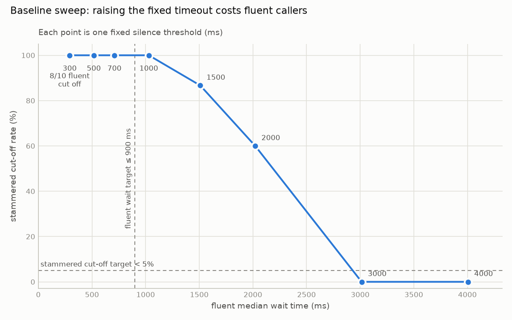

# Baseline threshold sweep

44 clips from the manifest, energy VAD (-45 dBFS, 32 ms frames), first `END` per clip, no padding.
Cut-off = first END before `true_end_ms`. Wait time = first END − `true_end_ms`, on clips not cut off.
"No end" = no END inside the clip: not a Cut-off, not in the wait stats.
Median and p95 use linear interpolation (numpy's default). With 10 fluent and 4 pauses clips, p95 is close to the maximum.

### fluent

| threshold (ms) | cut-off rate | no end | wait median (ms) | wait p95 (ms) |
| ---: | ---: | ---: | ---: | ---: |
| 300 | 80% (8/10) | 0 | 292 | 328 |
| 500 | 0% (0/10) | 0 | 518 | 530 |
| 700 | 0% (0/10) | 0 | 710 | 722 |
| 1000 | 0% (0/10) | 0 | 1030 | 1042 |
| 1500 | 0% (0/10) | 0 | 1510 | 1522 |
| 2000 | 0% (0/10) | 0 | 2022 | 2034 |
| 3000 | 0% (0/10) | 0 | 3014 | 3026 |
| 4000 | 0% (0/10) | 0 | 4006 | 4018 |

### stammered

| threshold (ms) | cut-off rate | no end | wait median (ms) | wait p95 (ms) |
| ---: | ---: | ---: | ---: | ---: |
| 300 | 100% (30/30) | 0 | - | - |
| 500 | 100% (30/30) | 0 | - | - |
| 700 | 100% (30/30) | 0 | - | - |
| 1000 | 100% (30/30) | 0 | - | - |
| 1500 | 87% (26/30) | 0 | 1510 | 1520 |
| 2000 | 60% (18/30) | 0 | 2026 | 2035 |
| 3000 | 0% (0/30) | 0 | 3016 | 3028 |
| 4000 | 0% (0/30) | 0 | 4008 | 4020 |

### pauses

| threshold (ms) | cut-off rate | no end | wait median (ms) | wait p95 (ms) |
| ---: | ---: | ---: | ---: | ---: |
| 300 | 100% (4/4) | 0 | - | - |
| 500 | 100% (4/4) | 0 | - | - |
| 700 | 100% (4/4) | 0 | - | - |
| 1000 | 100% (4/4) | 0 | - | - |
| 1500 | 50% (2/4) | 0 | 1512 | 1525 |
| 2000 | 25% (1/4) | 0 | 2010 | 2035 |
| 3000 | 0% (0/4) | 0 | 3007 | 3027 |
| 4000 | 0% (0/4) | 0 | 3999 | 4019 |
